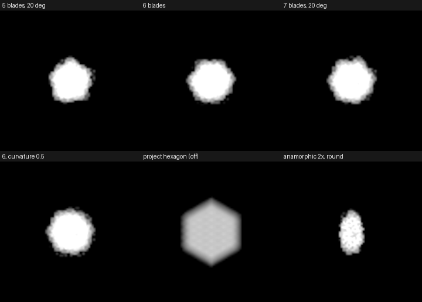
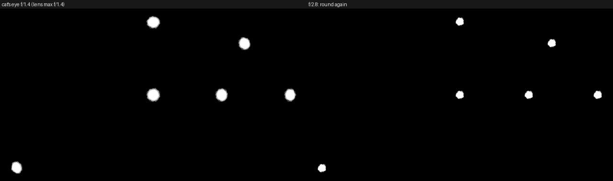
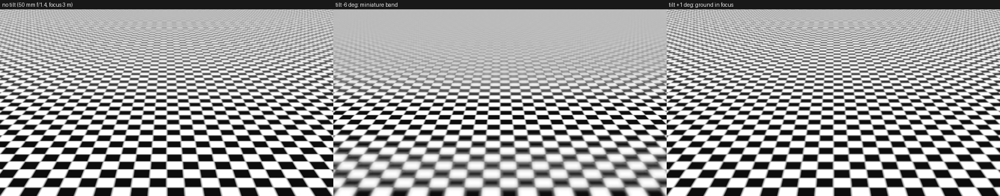
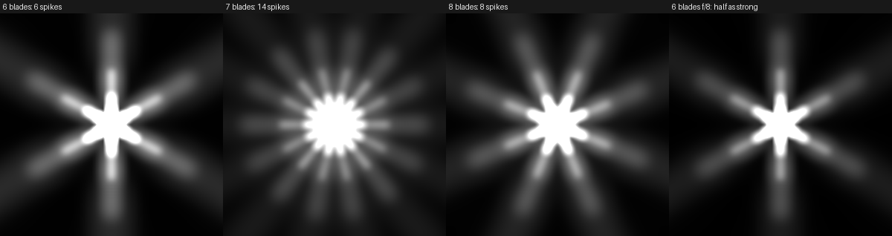
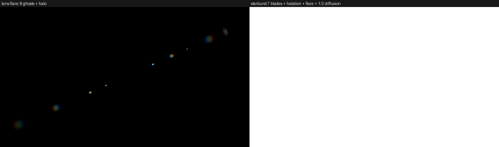
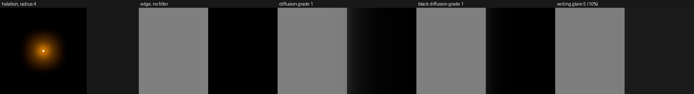
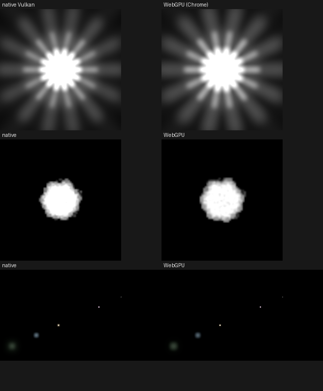

# Wiki text: Engine Additions → Bokeh, tilt-shift and glare (task 35)

Proposed page: **Engine Additions / Camera bokeh, tilt-shift and glare**. Images in `images/` (native Vulkan
Forward+ unless labeled).

---

## Camera bokeh, tilt-shift and glare

A real lens does more to light than focus it. Its aperture gives out-of-focus highlights a shape, its barrel clips
them toward the frame's edges, a tilted lens tilts the plane of focus, its blades diffract bright points into
starbursts, and stray light inside it and in the film makes flare, veiling glare and halation. Godot WebGPU models
each of these from the camera's physical settings where it can, with a strength slider on top.

All of them are **off by default**: an existing project renders exactly as before.

| Effect | Where | Forward+ | Mobile | Compatibility |
|---|---|---|---|---|
| Aperture blades (bokeh shape) | `CameraAttributes` › Aperture | yes | yes¹ | no (no depth of field) |
| Cat's eye bokeh | `CameraAttributes` › Cat's Eye | yes | yes¹ | no |
| Tilt-shift | `CameraAttributesPhysical` › Tilt-Shift | yes | yes | no |
| Starburst | `CameraAttributes` › Starburst | yes | yes² | no³ |
| Halation | `CameraAttributes` › Halation | yes | yes² | no³ |
| Lens flare | `Environment` › Lens Flare | yes | yes² | no³ |
| Veiling glare | `Environment` › Veiling Glare | yes | yes | no³ |
| Diffusion filter | `Environment` › Diffusion Filter | yes | yes | no³ |

The web export (WebGPU, Forward+) supports everything Forward+ does.

¹ Mobile's depth of field ignores `CameraAttributesPhysical`'s focus model (an existing engine limitation); the shapes
work with `CameraAttributesPractical`'s blur, and tilt-shift brings its own physical blur.
² Mobile stores the frame in a format that clips highlights at about twice white, so very bright sources make weaker
glare than in Forward+.
³ Compatibility tonemaps in its scene shader: its post-process only sees light clipped near white, without the
highlights glare is made of.

### Aperture blades

**What it does:** out-of-focus highlights take the shape of the lens's diaphragm: a polygon with as many corners as it
has blades, with straight or curved edges.

**How to use it:** on the camera's `CameraAttributes`, enable **Aperture** and set **Blade Count** (5-11 for most
lenses, 0 for round), **Blade Curvature** (0 = straight, 1 = round) and **Rotation**. This replaces the project's
`rendering/camera/depth_of_field/depth_of_field_bokeh_shape` for this camera only. An anamorphic lens
(`CameraAttributesPhysical.lens_anamorphic_squeeze`) makes the bokeh oval, taller than wide, automatically.

**Example:** a vintage 50 mm f/1.4 with 6 straight blades: `aperture_enabled = true`, `aperture_blade_count = 6`,
`aperture_blade_curvature = 0.0`. A modern lens with 9 rounded blades: `aperture_blade_count = 9`,
`aperture_blade_curvature = 0.6`.

**Limits:** the aperture is drawn by the circular bokeh's gather at half resolution, so it costs what the circular
shape costs at the project's bokeh quality, and is a little smaller and grainier than the full-resolution box and
hexagon passes.

### Cat's eye bokeh

**What it does:** toward the frame's edges the lens barrel cuts off part of the aperture, so bokeh become lemon shaped,
squeezed along the line to the center. It is strongest wide open and disappears about two stops down, as on a real fast
lens. With `CameraAttributesPhysical` it follows the aperture and `lens_max_aperture` (the same model as the physical
vignetting); with `CameraAttributesPractical` it is drawn as a lens wide open.

**How to use it:** enable **Cat's Eye** and leave **Strength** at 1 (physical) or raise it to 2.

**Example:** `CameraAttributesPhysical` with `lens_max_aperture = 1.4`, `exposure_aperture = 1.4`,
`cats_eye_enabled = true`: strong cat's eyes in the corners; at `exposure_aperture = 2.8` they are round again.

### Tilt-shift

**What it does:** tilts the lens against the sensor, which tilts the plane of sharp focus (the Scheimpflug principle).
A reverse tilt leaves only a thin band sharp across a scene seen from above, the "miniature" look; a forward tilt puts a
whole receding ground plane in focus, as landscape photographers use it.

**How to use it:** on a `CameraAttributesPhysical`, enable **Tilt-Shift**, set **Tilt** in degrees (negative for the
miniature look; real lenses tilt up to 8-15°, and small tilts already matter) and **Axis** (0 = horizontal band). The
band's angle follows from the tilt, the focal length and the focus distance, as on a real tilt-shift lens. Use a wide
aperture for a narrow band.

**Example:** a city seen from a rooftop: 50 mm, `exposure_aperture = 1.4`, `frustum_focus_distance` on the street,
`tilt_shift_tilt = -6`.

**Limits:** `CameraAttributesPhysical` only (it needs the focal length); ignored by an orthogonal camera.

### Starburst

**What it does:** bright points get diffraction spikes ("sunstars"). Each straight edge of the aperture spreads light
perpendicular to itself, so an even blade count gives as many spikes as blades and an odd count twice as many (7
blades: 14 spikes). Spikes get stronger as the aperture closes: f/16 gives twice the spike light of f/8. The spikes'
light is taken from the highlight itself, so they never brighten the picture overall.

**How to use it:** enable **Starburst**; the spikes follow the **Aperture** group's blade count, curvature and rotation
(whether or not the aperture also shapes the bokeh). **Strength** 1 is the physical amount, which only the sun shows;
game lights usually want 10-50.

**Example:** a street light at night: `exposure_aperture = 16`, `aperture_blade_count = 7`, `starburst_enabled = true`,
`starburst_strength = 30`.

**Limits:** the most expensive of these effects (16 anisotropic texture reads per spike line per pixel); round blades
(curvature 1) have no spikes.

### Halation

**What it does:** the red-orange glow film shows around highlights: light reflects off the back of the film base and
exposes the emulsion again around the highlight, mostly its red layer. The halo's size is physical (about 0.2 mm on the
film), so it is tighter on larger formats. Light is moved into the halo, not added: flat areas keep their color.

**How to use it:** enable **Halation**; **Strength** 1 is film without its anti-halation backing (CineStill-like),
**Radius** scales the halo. Pairs well with **Grain** (type Film) for a film look.

**Limits:** Forward+'s glare chain cannot draw a halo narrower than about 1% of the frame height, so radius 1 shows as
about twice its physical size (Mobile about 0.4%).

### Lens flare

**What it does:** bright light makes ghosts: reflections between lens surfaces that land mirrored through the frame's
center, each scaled, defocused and tinted by its coating, and a halo ring. They follow every bright thing in the frame
(lights, emissive materials, the sky's sun) because they are computed from the image.

**How to use it:** on the `Environment`, enable **Lens Flare**. **Threshold** is the brightness (1 = display white)
above which light makes flare; **Intensity** 1 is an older single-coated lens; **Ghost Count** up to 8; **Halo
Intensity**; **Chromatic Aberration** fringes the ghosts.

**Example:** `lens_flare_enabled = true`, `lens_flare_intensity = 10`, `lens_flare_ghost_count = 6`,
`lens_flare_halo_intensity = 3`.

### Veiling glare

**What it does:** light scattered inside the lens spreads over the whole frame and lifts its blacks by a fraction of
the frame's average brightness: the washed-out shadows of a shot toward a bright window.

**How to use it:** enable **Veiling Glare**; **Strength** 1 spreads 2% of the light (a modern lens), 5-10 an old or
uncoated one.

### Diffusion filter

**What it does:** a Pro-Mist-style filter in front of the lens scatters part of all light into a wide soft halo:
highlights bloom and the shadows near them lift. **Black** is the Black Pro-Mist kind: a tighter halo with half the
scatter, so shadows stay dark.

**How to use it:** enable **Diffusion Filter**; **Strength** is the filter's grade (0.125, 0.25, 0.5, 1, 2).

### On the web

Everything above runs in the WebGPU export (Forward+) and measures the same as native Vulkan; the starburst's spikes
are slightly brighter and the halation slightly tighter in Chrome, whose anisotropic filtering differs a little.

